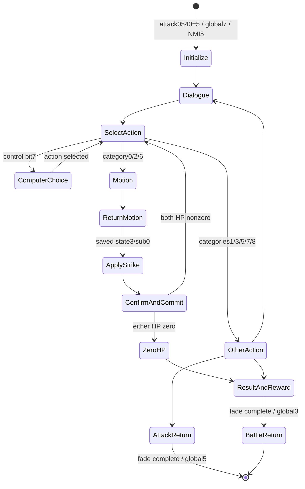

# 单挑状态机：控制流程闭合及验证边界

本目录恢复的是这份ROM的单挑控制区域，而不是原作者源码。主更新为bank23 `$A01B → $B100`；可执行重建覆盖bank23/24 `$B100..$CDFC`，22个有效主状态、19张有严格边界的分派表、92个不同子处理入口、2824条指令/6772字节，静态解码没有重叠冲突。主状态10/11/12是状态0初始化入口的别名，不能误解为三个独立动作。状态8是一次性函数，忽略子状态。

核心控制、整数运算、读写、内部调用和尾跳转都由源码执行，未以“去调用ROM入口”替代处理器。精灵、声音、对白、淡出及区域外共享函数仍是显式依赖；当前并非不依赖ROM的完整游戏引擎，也并非全部流程都改写成了高层算法。

## 入口与返回

普通攻击场景bank14 `$A069/$A06C`读取`$0540`，其11项真实指针表中**索引5**指向bank15 `$CD43`，这是单挑前置场景。`$CD43`又用`$0541`分派至`$CD4F/$CD59/$CDCF`。`$CD59`等待`$0087`负值并调用`$E768`清理后，设置global`$007A=7`，清`$04A8/$04A9/$04AA`，复制或交换`$0560/$0561`双方ID及`$0562/$0563`控制代码。控制代码3转为`$80`；若左代码不为0且右代码为0或1，则交换双方。

fixed31 `$E2E8`随后设置NMI模式`$0078=5`，执行单挑背景/肖像等建立流程，令global状态进入8。真正逐帧驱动位于NMI5 `$F9A0`，`$F9CD`调用pair23 `$A01B`。该NMI先在`$F9A9/$F9AB`清`$007C`，这是OAM循环的必要前置条件；不能把任意继承的OAM字节数当作合法入口状态。

state14/sub1 `$C33B`等待淡出完成后设置battle`$0500=11/$0501=0`、global`$007A=3`，再调用`$ECBF`完成场景切换。state15/sub1 `$C480`则回global5的普通攻击显示流程。两条路径仅当`$050F!=3`时恢复`$050F → $6F44`。普通战斗菜单经`$A325 → global5`进入的是普通攻击显示，不能直接标为单挑。

完整入口证据见[entry_catalog.json](entry_catalog.json)。

## 状态、条件及边

[handlers.md](handlers.md)逐项列出22个主状态和每个有效子处理器的中文行为说明、入口、条件分支、绝对地址写入、控制写入和外部依赖。其名称描述机器行为；未匹配菜单像素的动作类别0/2/6使用数字命名，未猜测招式名。

[state_machine.json](state_machine.json)保存全部表项、每个处理器的可达指令及CFG；[state_transitions.json](state_transitions.json)保存可能的主/子/global状态写入及来源PC。条件路径上的写入不是无条件转移。动画的动态返回也明确记录：state19/sub2、state20/sub2、state21/sub2从`$04BD/$04BE`恢复主/子状态。



此图是主要路径摘要；所有有效子状态和额外动态分支以机器可读表为准。

## 关键字段及永久写回

| 地址 | 已证实作用 |
|---|---|
| `$04A8/$04A9` | 主/子状态 |
| `$04AA` | 当前行动方0/1；某些败退路径变为败方 |
| `$04AB/$04AC` | 双方控制代码；bit7走电脑选择 |
| `$04AD/$04AE` | 双方武将ID；可能与原attack顺序交换 |
| `$04AF/$04B0` | 武器动画分类，低5位武器ID `<8→2,8..15→0,16+→1` |
| `$04B1/$04B2` | 临时体力 |
| `$04B3/$04B4` | 体/武与武器、防具修正计算的单挑参数；不直接称伤害 |
| `$04B5/$04B6` | 低7位持续效果、bit7标志；准确玩法名称仍待对应 |
| `$04BD/$04BE` | 随阶段复用为随机比较量、对白编号或动画返回主/子状态 |
| `$04BF` | 动作类别/对白结果，在资料状态中复用为原actor |
| `$0514/$0516` | 退出时保存双方ID |
| `$0515/$0517` | 单挑结果：0普通、1退却/説得后回普通攻击场景、2零体力、3投降、4另一説得分支；不等同于武将记录status低2位 |

bank24 `$D060..$D073`按side0再side1把临时HP写到真实SRAM武将记录`$63C0+12*ID`的byte0；同一ID时side1覆盖side0。初始化state0/sub5和普通扣体后的state3/sub1都会调用，写回并非只发生在最终退出。

普通攻击state3/sub0先改临时HP，state3/sub1等待对白及A/B确认才提交永久HP，state3/sub2等待显示完成后优先检查当前actor，再检查另一方。双方均零时当前actor先被选为败方。零HP仅使此控制器写`$0515/$0517=2`；本区域没有将武将byte11低2位写3、永久删除武将或作俘虏表更新。后续战斗结果处理有独立路径，不能据此宣称死亡、复活或永久删除。

state4/sub6 `$BB5B`是另一条真实永久体力扣减路径，直接改武将记录byte0，扣量`R(10)+5`并保留SBC/BPL的带符号裁剪；这与普通临时HP路径不同。state14/sub2的特殊装备奖励分支也保留在IR中。

武器、防具字段已有像素/名称证据：byte10低5位为武器，高3位为防具；高3位不是马。byte11中间2位显示平/山/水，地形适性的强推断与命名证据见其他字段报告，不在这里称兵种。

## 两种可执行接口

[duel_state_machine.py](../../source/recovered/duel_state_machine.py)提供：

- `DuelMachine(memory, hooks=None).tick()`：对共享64KiB地址空间进行一次真实控制器更新；`phase(state,substate)`仅用于明确设定入口的样例。
- `prepare_duel_handoff_header`：`$CD61..$CDCE`在淡出/清理后的真实头部写入，包括双方交换与control3转换。
- `initialize_duel_records`、`route_duel_action`、`check_duel_strike_end`、`prepare_duel_return`、`finish_duel_return`、`commit_duel_hp`：独立易读游戏作用，附原入口与边界；它们不承诺保留CPU scratch/flags，返回的显示/对白工作必须由宿主真正执行。

`DuelMachine`保留CPU寄存器、flags、栈和临时地址作用。其操作数据来自[program.json](program.json)；运行时不获取ROM指令。RAM/SRAM可传flat64KiB数组或项目的mapper Bus。异常状态索引会抛错。默认`ControlHelpers`独立实现EADE、F2D7与固定RNG入口；其他缺失依赖会抛`MissingSharedHelper`，未恢复目的地抛`UnresolvedDependency`。

严格外部接口为`hooks(context,target,return_pc,kind)`：context包含memory、registers及push/pop；kind为call、tail、dispatch或far_call。宿主必须更新PC、A/X/Y、SP、flags及内存副作用。farcall依Y选择银行并消费inline目标指针；tail没有普通JSR返回地址。把显示函数空操作化或只改PC会改变后续控制结果。

## 已完成验证及尚未闭合部分

[validation.json](validation.json)记录348个主/子状态×按钮样例，全部与实际ROM的寄存器、flags、栈、RAM、SRAM及银行映射相同；这些样例执行1910/2824条IR起点。加入3条连续tick构造序列后覆盖1959/2824，而不是全部指令路径。

409个高层语义样例对照实际入口的声明游戏作用；72个写回样例覆盖不同/同一ID和HP字节边界0/1/100/127/128/255。连续tick样例明确注入对白完成/显示完成及动画跳过条件，不作为独立动画实现验证。校验适配器仍执行29种区域外原ROM共享函数；它们不能算成独立恢复的源码。静态目录共有34种外部目标，其中F2D7与E87A已有独立共享源码，EADE分派另由共享源码执行。

[runtime/injected-core/validation.json](runtime/injected-core/validation.json)是完整Nestopia核心的**注入场景集成验证**：原ROM不变，导入既有战斗快照后注入global7、双方ID/控制、HP80/5及由已验证参数算法算出的缓冲值；每个注入字段、完整输入计划、核心版本/哈希均记录。1025帧实际经历state0→9→1→16→19→3→1→16→19→3→13→14，随后第997帧global3/battle11/sub0，第1008帧global4。

第446帧临时HP变74/5，第482帧永久记录提交74/5；第766帧临时HP变74/0，第802帧永久记录提交74/0。双方status低2位在整个记录中保持2/1。返回战斗后曹操经验由1000变1044，这属于后续战斗处理的观察，不能归为单挑控制器内部算法。

两次完整核心fixture的40个有内容的像素/RAM/SRAM/core.state快照SHA256全部一致，帧转移记录也一致，见[runtime/reproducibility.json](runtime/reproducibility.json)。该核心libretro memory3返回0字节，因此10个空`*-vram.bin`被排除，**VRAM直接导出不可用，未验证其内容**。它验证原ROM实际动画、NMI、确认与收尾的配合，**不证明正常输入从冷启动可达此fixture**。`runtime/nav-*/`是未注入的原游戏移动探索，目前仅到战斗移动和武将选择，尚未自然触发单挑。


整套源码属于可运行的逆向重建，仍需外部显示/场景函数。完整依赖语义、所有未执行分支和自然触发过程，是当前具体剩余边界；没有把这些边界伪装成完整游戏源码。

## 复跑

```sh
.venv-trace/bin/python scripts/analyze_duel_fsm.py /Users/paulasmith/Downloads/三国志2超级版.nes
.venv-trace/bin/python scripts/verify_duel_fsm.py /Users/paulasmith/Downloads/三国志2超级版.nes
PYTHONPATH=.venv-trace/lib/python3.13/site-packages python3 scripts/verify_duel_fsm.py /Users/paulasmith/Downloads/三国志2超级版.nes --core-fixture
```

前两条使用py651.2.0的`.venv-trace`；核心fixture使用当前系统Python3.13/Pillow及同一py65包路径，还需项目固定的Nestopia dylib和来源snapshot。所有脚本只读取原ROM，SHA256固定为`26c8d921ff5c208191f136480bcd8d7e89c2e4ed40a0ac7b51482bcb52fe2b82`。

第四轮已将退却state4、投降state6、説得state7、罵倒state8的正式菜单文字与独立游戏效果源码对应，见[更新报告](../phase4/duel/README.md)。结果码1由多个路径写入，不能全局命名为单一行为。
