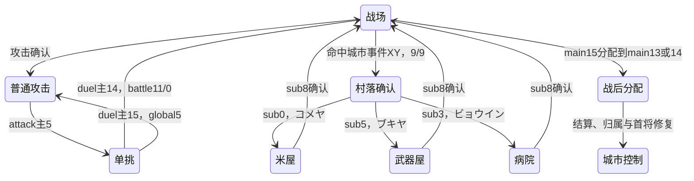

# 第四轮：补全跨银行状态与独立可读规则

继续沿用指定的REA工程及其6502适配、Ghidra汇编/候选函数证据。本轮把原先外部依赖中的单挑AI与结果、战后名册、地图服务和固定辅助服务恢复成可读源码，新增原ROM指令对照验证。没有修改输入ROM，也没有把Ghidra候选伪代码当原作者源码。

[状态机浏览器](index.html) · [源码入口与使用](../../source/README.md) · [联合验证](verification.json) · [前轮完整控制目录与回放](../phase3/README.md)

## 状态机本轮补全的部分

| 层 | 状态与入口 | 本轮结果 |
|---|---|---|
| 战斗地图 | 16主状态，bank12/13 A028，0500/0501 | 本地分派目录保留；main9确认村落服务；main13败方转移/在野，main14胜方收容/超额转移 |
| 村落服务 | bank9 C0BB；main9的sub0..9 | 新增10项真正子分派，表C0C1..C0D4，首handlerC0D5，799条独立控制IR |
| 普通攻击 | 11主状态，bank14/15 A069，0540/0541 | main5进入单挑，main4返回战斗；控制目录保持原11项边界 |
| 单挑 | 22主状态，bank23/24 B100，04A8/04A9 | 主4退却追击、主6投降、主7説得、主8罵倒、AI、体力写回与奖励恢复为独立高层规则 |
| 战后电脑分配 | bank8 BC46，3个mode | 填当前城/相邻城/来源城、溢出转在野、首将/君主与原scratch异常行为 |

**范围纠正：**前轮101个battle组合是pair12/13本地控制图和bank8结算别名展开数；它包含main9的C1FC桥接入口，并没有展开bank9服务表。这里明确增加外部10子状态，没有把两者简单相加为101个独立完整玩法。全部合法入口覆盖、动态指令覆盖和图形实际运行分别报告。



每个村落子入口的分支、字段写入、ROM偏移和外部依赖在[服务目录](terrain/service-controller.json)及[完整汇编](terrain/service-controller.asm)；完整三台scene目录仍在[battle](../battle_fsm/all-entries.md)、[attack](../attack_fsm/state-catalog.json)、[duel](../duel_fsm/handlers.md)。

## 单挑动作与结果字段

原字形和菜单索引确认：0けんせい（牽制）、1たいきゃく（退却）、2こうげき（攻撃）、3こうさん（投降）、4せんじゅつ（戦術）、5データ、6すてみのこうげき；戦術子菜单7せっとく（説得）、8ばとう（罵倒）。[原字形/核心截图](terrain/README.md)与[独立规则](duel/README.md)保留映射证据。

罵倒的04B5低7是持续计数。它使攻击判定的roll加20，通常降低命中机会；伤害按原字节溢出计算后加floor(u8(3D)/10)。bit7已确认用于电脑避免重复选择罵倒，不把它扩展成所有路径通用免疫标志。每次选中行动者减持续计数，不能把初值3..5直接称作3..5次有效攻击。

结果码0515/0517与武将byte11状态低2位是两种字段：0正常，1返回普通攻击场景，2零体力，3投降后的被俘处理，4説得后的转属处理。bank13 C782/C787的下游可记录俘虏、OR3并移除战場槽，或改阵营并调用忠诚调整服务；5..7共用转属handler但本轮未确认其产生入口。结果码1来自多条路径，不能统一命名为劝降；健康写回本身也不等于写永久死亡标志。

独立源码保留原AI的两个特殊边界：B7B3尾跳F2D7返回记录地址高字节，不能改成概率；B659低体力分支用HP xor1作为数组下标，不能改为actor xor1。正式名称不会覆盖这些真实读写行为。

## 战后转移与在野

主13处理败方可收容邻城或选30在野；主14在≤10人时收容入当前城，超过10人时先移出/转在野再收容。原选项30为「ざいや」，确认句为「ざいやにかえすブショウをえらんで…」。这些是名册转移流程，不叫招降或处刑菜单。

收容写城市名册时不会统一把武将status改2；原packed状态和位置保留。BC46与人类流程对中立城owner高位、名单次序和未满/满员情况也有不同处理，源码逐路径保留。BC46 mode2满来源城会保留EADE的scratch04=BD；溢出释放会覆盖原君主比较scratch02，下一人可能因ID与城市邻接行偏移相等而OR3。这些异常单独有对照用例，未当设计规则或全部自然可达证明。

[战后报告、14阶段与连续链](postbattle/README.md) · [源码](../../source/recovered/postbattle.py)

## 地形和村落字段

30城、120地图chunk共有17,670个有效格（x<31、y<20、y≠15）。raw6/7/8在有效格分别有26/22/9个，不是只存在于属性行。玩家DB46与电脑B6E5均将≥6折为移动class2；兵量缓存063C≥6选择第一成本表，正常槽对应低10位兵数≥600。

村落类型由bank17 9BA4的3组XY顺序决定：0米屋（コメヤ）、1武器屋（ブキヤ）、2病院（ビョウイン）。67个非空事件坐标中，55个落在raw6/7/8，12个落在普通class2；另有2个marker不匹配事件表。不能把raw6/7/8逐一等同三种店，也不能把它们命名成一次性宝物。入口写battle9/9、0470服务索引，消息A7原文「ムラにはいりますか」，本段不写已领取位。

资源买卖的截断/16位回绕、装备武器/防具位字段及四种稀有购买限制、50金恢复35..45体并受原始体力上限约束，均已独立对照；异常体力仍保留8位回绕。[地形和服务报告](terrain/README.md)说明报价参数各分支的方向及前置条件。

raw1正式地形名仍未恢复，只确认平滑土色画面和独立成本；兵数高6位也没有足够证据命名为独立flag。源码保留原始字段，没有用现代常识补名字。

## 16计略名称与执行绑定

名称保持原CHR字形，连接0580菜单行→0543选择值→B02B/执行表。它们已整合到game_enums、battle和AI选择结果；名字绑定不等于每一动画已独立实现。

| ID | 原字形名称 | 行动成本 | 效果入口 |
|---:|---|---:|---|
| 0 | 火計 | 6 | bank12 `$B062` |
| 1 | 陥穽 | 5 | bank12 `$B0DD` |
| 2 | 虚兵 | 4 | bank12 `$B155` |
| 3 | 要撃 | 6 | bank12 `$B17A` |
| 4 | 乱水 | 7 | bank12 `$B1D5` |
| 5 | 火箭 | 8 | bank12 `$B243` |
| 6 | 偽撃転殺 | 8 | bank12 `$B062` |
| 7 | 共殺 | 8 | bank12 `$B2CD` |
| 8 | 籠絡 | 10 | bank12 `$B31C` |
| 9 | 落石 | 9 | bank12 `$B3B6` |
| 10 | 連環 | 9 | bank12 `$B3D0` |
| 11 | 十面埋伏 | 10 | bank12 `$B42A` |
| 12 | 水攻 | 10 | bank12 `$B466` |
| 13 | 連弩 | 8 | bank12 `$B4B8` |
| 14 | 劫火 | 12 | bank12 `$B50C` |
| 15 | 奇門遁甲 | 10 | bank12 `$B5A6` |

[原字形、索引和指针对照](../names_terrain/README.md)

## 源码与验证层次

新GameEngine接口：duel_rules、postbattle_rules、process_ai_officers、settlement_rules、movement_quote、enter_map_service和tick_map_service，统一使用同一RAM/SRAM。高层规则不调用原ROM指令；控制IR保留flags、栈和溢出行为；mapped=True启用只读PRG数据银行及独立固定服务。

29个固定服务包含菜单导航、消息排队、PRG切换、RNG、数学/BCD/寻址和音序请求，共482条IR指令。消息实际写原队列、音序实际写原channel参数；它们不假装完成显示或合成声音。4015写作为明确硬件请求保留，未知PPU读写仍报错。[服务报告](services/README.md)

| 本轮模块 | 原ROM差分用例 | 比较范围 |
|---|---:|---|
| 独立单挑规则 | 13,340 | 声明游戏字段、完整SRAM、随机游标；含216/216説得表项 |
| 独立战后规则 | 9,788 | 完整SRAM、声明名单/玩法buffer、消息ID；14阶段与连续链 |
| 地图与村落 | 27,638 | 所有合法格、归一、坐标事件、交易/装备/治疗；含120个服务IR入口case |
| 独立固定服务 | 14,848 | 全寄存器/flags/SP/PC、RAM/SRAM、PRG映射及4015请求 |
| 共享入口整合 | 8 | 原NMI映射前提、共享内存及村落等待入口CPU对照；另列不混入模块差分 |

本轮四模块合计 **65,614** 个差分用例全部通过。服务IR动态执行655/799条；三台前轮控制器的执行覆盖仍单独保留。新增单挑另4个缺少等待输入的契约检查证明会报错且不推进状态。固定服务原指令位置访问478处；静态482条全部可逐字节追溯。

村落控制IR验证对未恢复helper使用显式原ROM adapter；高层效果与固定服务自身没有原代码调用。CPU-only oracle、合成RAM/SRAM的完整Nestopia像素、前轮自然冷启动回放是不同证据。新正式NPC/在野截图都是明确的受控fixture，不能据此声称自然战役已经走过全部分支。REA现有pair08与pair23的完整load image均verified；C0BB服务候选函数与新手工内联表校正对应，原REA证据留存。

## 复现

```sh
python3 scripts/game_engine_demo.py --mapped --tick
.venv-trace/bin/python scripts/verify_duel_logic.py '/Users/paulasmith/Downloads/三国志2超级版.nes'
.venv-trace/bin/python scripts/verify_postbattle.py '/Users/paulasmith/Downloads/三国志2超级版.nes'
.venv-trace/bin/python scripts/verify_terrain_rules.py '/Users/paulasmith/Downloads/三国志2超级版.nes'
.venv-trace/bin/python scripts/verify_runtime_services.py '/Users/paulasmith/Downloads/三国志2超级版.nes'
.venv-trace/bin/python scripts/verify_source_integration.py '/Users/paulasmith/Downloads/三国志2超级版.nes'
.venv-trace/bin/python scripts/verify_phase4.py '/Users/paulasmith/Downloads/三国志2超级版.nes'
```

原ROM SHA256：`26c8d921ff5c208191f136480bcd8d7e89c2e4ed40a0ac7b51482bcb52fe2b82`，与重建文件逐字节一致。源码、数据、汇编、运行证据、报告与可复现脚本一起更新到[归档包](../../build/三国志2超级版-逆向分析.zip)。

剩余独立实现包括完整PPU/IRQ/文本绘制、全部音频合成、全局内政/战役与转属服务等；退却返回普通攻击场景后的完整表现也未扩展证明。本轮交付可读规则和有边界的完整分派控制目录，尚不是可以独立游玩的完整重制游戏。

第五轮已继续恢复内政AI、名册转移和继承，并确认兵高位可由数值溢出产生；[最新报告](../phase5/README.md)纠正了A006/A00C调用的政治语义标签。
