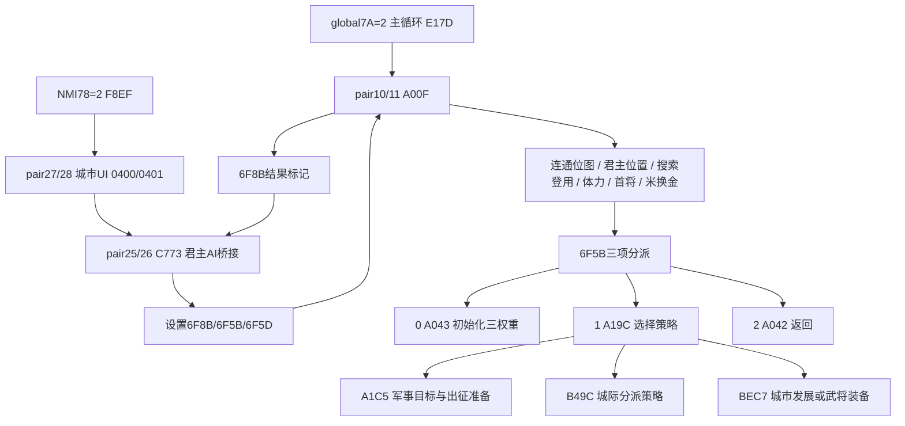

# 君主内政 AI、城市字段与回合调度复原

本轮恢复了原 ROM 的 pair10/11 君主决策控制、三路策略选择、城市发展的一次完整决策/付款/效果、城市/武将筛选、月份推进、外交计时衰减、年度金米收取，以及 pair25/26 三个回合控制器。可读代码是从机器码复原的模型，**不是原作者源码或完整游戏重制**。

[源码 domestic_ai.py](../../../source/recovered/domestic_ai.py) · [城市 schema](city-schema.json) · [AI 指令/调用证据](evidence.json) · [AI 完整有边界汇编](control.asm) · [三调度器目录](turn-controllers.json) · [调度器汇编](turn-control.asm) · [原 ROM 对照](validation.json)

ROM SHA-256：`26c8d921ff5c208191f136480bcd8d7e89c2e4ed40a0ac7b51482bcb52fe2b82`。下列 file offset 均包括 16 字节 iNES 头；原 ROM 只读。

## 主循环与 NMI 分工

固定 bank31 的 global `$007A=2` 指向 `$E17D`，主循环选择 physical pair10/11，然后调用 bank10 `$A000→A00F`；另一方面，NMI `$0078=2` 经 `$F8EF` 选择 pair27/28 `$A000`，维护 `$0400/$0401` 的城市 UI。**NMI scene2 与君主 AI 入口是不同层**。

pair10 `$A00F` / file `0x01401F` 使用 `$6F8B`：负数直接到 `$A042` 的 `60 RTS`；值1到 `$A8D7` 的战斗归来处理；其他非负值执行预处理，再按 `$6F5B` 的三项 inline table 分派。权重初始化在 **`$A043`**，不是 `$A042`。



`$A039` 的原三指针位于 `$A03C..A041` / file `0x01404C`：`43 A0 9C A1 42 A0`。`$A1BC` 另一张三指针位于 `$A1BF..A1C4` / `0x0141CF`：`C5 A1 9C B4 C7 BE`。两处都使用自定义 `$D494`，它弹出 JSR 返回地址、从后续 inline word 取目标、保留原 Y，并经 `$0023` 跳转。复原的 `DomesticDispatch` 保留其 scratch、flags 和 stack 行为，没有把指针数据当 opcode。

## 城市 32 字节结构

30 城记录的初始数据从 file `0x020C10` 复制到 SRAM `$6000`，stride32。仅靠初始数值无法辨认字段：这份超级版将多项 raw word 都设成9999。字段名称来自自然原 core 属性画面、实际数字格式三元组及读写路径共同联接。


bank29 `$AF77` / file `0x03AF87` 解释模板三元组 `[format,digits,cityOffset]`；模板 `$B3E5`、`$B4C1`、`$B59C` 分别对应内政、军事、计略页。所有原三元组 CPU/file/bytes、行列都在 `city-schema.json`。

| byte offset | 长度 | 字段 / 原显示 | 确认证据 |
|---:|---:|---|---|
| 0 | 1 | ruler低3位，其他5位 flags | `$D105` 按 `&07` 比较君主；其他位按路径保留 |
| 1 | 1 | 未决 byte1 | 不填猜测名称 |
| 2 | 2 | 金 / gold | 模板 `$B404: F1 04 02`；付款 `$D36F`；战场 `$0526` 写回链 |
| 4 | 2 | 米 / grain | `$B409: F1 04 04`；付款 `$D3A9`；战场 `$0522` 写回链 |
| 6 | 2 | 人口的百人单位 raw word | `$B459: F1 05 06`，其后原模板接两个 `0`，正常显示 `raw×100` |
| 8 | 2 | 土地 raw word | `$B425: F1 03 08`；发展/收入路径另取 low10 |
| 10 | 1 | 防災 | `$B478: F2 02 0A`；发展效果 `$C117..C126` |
| 11 | 1 | 統治度 | 君主/太守页 `$B3D3: F2 03 0B`；发展与收入档位 |
| 12 | 2 | ヒカエ / 预备兵 | 军事页 `$B58A: F1 05 0C`；攻击准备从此扣除补兵量 |
| 14 | 2 | 産業 raw word | `$B441: F1 03 0E`；发展/收入路径另取 low10 |
| 16 | 1 | タカラ / 宝物数量 | `$B615: F2 02 10`；获取消息34与出售消息76、实际增减链 |
| 17..26 | 10 | 武将名册 | 固定10槽，FF空位；UI F0计数与 F3原始兵字段合计 |
| 27..31 | 5 | 辅助字段，完整语义未决 | 保留原字节 |

### raw、显示与计算不能混合

数字解释器 `$AFC0` 对 F1读取完整 LE16；只有取出的十进制位数决定显示范围。土地/产业三位显示原数值的最低三位：**原9999显示999**。年度收入却分别把土地/产业的高 byte `&03`，所以此时有效值是 **783**。`CityRecord.land/industry` 返回 raw；`displayed_land/industry` 和 `income_land/industry` 分别暴露这两种视图。

人口 UI读取完整 word，年度收入独立使用 `raw&7FFF`。武将总数模板 F0扫描全部10槽；AI `$D307` 的 prefix count 在首个FF停止，这两个计数对有洞名册也不等价。兵士总量的 F3直接累加每名武将 **raw LE16**，不套 low10 mask；兵高位可由合法征兵配置流程产生，详见[兵字段源码及作用域](../../../source/recovered/troop_fields.py)。

### byte16 的原图形与文字

顶部是图标，不把它转写为“弓”或命令点。原代码 `$A93E..A96B` 在 `$0470=4` 时增加 city+16、封顶99，然后排消息34。未修改 ROM 的完整 core 受控绘制明确显示 **「タカラを 12つ みつけました」**、**「クニに しまっておきます」**；`$C4E1..C4FB` 出售时扣 city+16，增加金并排消息76「キン…を てにいれました」。


此处12为明确注入的显示参数，截图是 synthetic fixture，不是自然事件概率或 campaign 可达性证据。`resource16-fixtures/*-fixture.json` 记录全部 RAM 初始化与原 state SHA。byte16 上部图标四 tile 为 `4E 4F 5E 5F`；真实显示期间使用 physical CHR bank5，而 state 最终 BG banks为8/9/13/12，显示采用分时换页。图标及「タカラを」原16字节/CHR fileoffset/NMT代码与真实 PNG 逐像素相同，详情在 schema 的 `resource16_glyphs`。城市画面的像素位移为0，不沿用前轮战场的−2假设。

## 策略权重与军事目标

`$A043..A0D2` 按难度0..2、君主0..6读取三张 `3×8` 表 `$A133/$A14B/$A163`，再根据邻接/名册统计的比例分档 `<31`、`31..70`、`≥71`，加入 `$A17B/$A186/$A191` 的修正。各 byte 相加都回绕。输入统计器 `$A0D3` 保留具体邻接扫描顺序，不能把它随意替换成一个通用国力评分。

`$A19C` 用 `$D4AD` 从随机数 **低4位** 拒绝采样，然后比较第一权重及前两权重之和。即使权重总和大于16，样本范围仍只是0..15。这会影响三个策略的实际比例；源码没有改为常规加权随机。固定随机排列位于 `$E8BA` / `0x03E8CA`，此 AI 使用 `$0052/$0054/$0055` 三个独立 byte 游标。

军事目标 `$A240..A2D2` 从30城扫描本方城市及原邻接表，跳过空属主7、本方和外交 nibble 仍非零的势力；优先较少 prefix 武将的敌城。同人数接受后遇到的不同敌城；同一敌城重复出现时选本方 prefix 武将较多或相等的城市。`choose_attack_target()` 保留这个扫描/tie行为，没有以排序“优化”。邻接表在 bank16 `$9D72` / file `0x021D82`，每城最多8项，以符号位终止。

出征路线按实际次序：`$A303` 找同连通工作位图的友城补充武将 → `$A45C/$A481` 把选将有效兵量补到1000 → `$A6C9/$A74A` 决定人数与金米 → `$A79C` 搬移名册并准备战场资源。补充将选择排除君主ID：默认取最大武，另一模式取最大忠且跳首槽，相等取后来槽。部分异常输入在原代码会留下 offset0 fallback；独立高层选择返回 None，原 IR保留原写入行为，不把这种异常假装成安全成功。

出征人数减项按难度的随机三档，原表 `$A6C0/A6C3/A6C6` 为 `[30,20,10] / [60,50,40] / [90,80,70]`；出征粮为人数×120，金为人数×100再按原采样加减0..99。实际 donor/不足处理与预算 unwind 保留在控制IR中。

## 搜索、登用、首将与低资源优先处理

正常 AI 入口先运行 `$D4CB→C50E→C5B9→C79A→C98F→D249→CC12`，再执行三策略选择。它不是每次先掷三个选项的简单策略。

- `$C5D2` 检查城市属主、随机10%门槛、未满10将；逐项读取原登场年份表，对 status1、年份达到的武将尝试登用。成功写 status2并追加城名册。
- `$C6CC` 另扫描237记录中 status0的武将，接受当前城或其邻城的 byte5位置，按原概率招入并调用忠诚 helper。
- `$C66F` 的普通概率10；君主4偏好 IDs `{109,112,55,183,144}`，君主2偏好 `{86,99,57,165,156}`，君主3偏好 `{107,234,235,213,47}` 时概率90。这些是机器码 ID条件，不靠人物故事补出倾向。
- `$C9A5..CA18` 重新选择首将：忠=100立即胜出，否则比较 `u8(忠+徳)`，相等取后来槽，并与首槽交换。溢出不改成无限精度加法。
- `$C248/$C2EB` 的武将选择恰好相反：从未处理标记中选最小忠/知，相等保留早先槽；忠 route排除100，原初始FF意味着255永不胜出。武将提高忠/知及装备购买分支的其余控制体都在IR，不宣称选择 helper本身已经完成整个任务。
- `$CC12` 在金<50且城市静态服务位允许时，根据米减去保留量、最多300的原转换路径增金；严格24/16位运算与分支留在IR。

忠诚 `$CF3F/$D00C`、君主死亡继承 `$CA19..CC11` 由[名册/继承模块](../transfer/README.md)独立恢复。它们在本控制器仍是明确 CPU hooks，不能直接把只返回游戏字段的高层 API当作没有flags/stack影响的 CPU 子程序。

## 一次完整城市发展规则

`domestic_development_once()` 独立执行 `$BEC7` 的一个城市选择/发展迭代，直到回 `$BEC7`、转 `$C1E0` 武将/装备阶段或结束回合。它不执行原 opcode。

城市循环 `$BEE6` 使用 `$6F83[ruler]` 的**先递增**游标，越30回0；全局 `$6F62` 第三次回绕结束该AI回合。每次读取 city会按 `$D105/D69D` 封顶金/米9999，这是读取路径的真实副作用。

第一随机数0..79与君主阈值 `[20,50,40,30,40,60,50]` 比较；达到阈值进入武将/装备阶段。否则第二0..99分派：

| 第二采样 | 发展字段 | 实际付款与增量 |
|---|---|---|
| 0..39 | 月index3..7为土地，否则产业 | 金10..23；`floor(cost×[12,15,18]/10)`；統治度另加1或2 |
| 40..69 | 人口 | 同金成本/倍率，结果再整除2；統治度另加1或2 |
| 70..89 | 防災 | 金10..19；`floor(cost×[6,7,8]/10)` |
| 90..99 | 統治度 | 先金30..59、再米30..59；`floor((金+米)/[25,20,15])` |

钱/米不足时保留原 RNG推进和已完成的扣款：例えば統治度分支金已经扣除而米不足，金不会自动退回。发展 word先16位相加，随后 maskhigh；封顶采用**两个分开的 byte比较**。因此异常高位不能改成普通 `min(total,cap)`。防災/統治度先8位相加，再封顶99。实际完成发展后 `$D152` 扣5预算；byte预算先回绕存入，0或借位结束。

`$D12D/$D152/$D165/$D178/$D18D` 的预算是 SRAM `$6F5D`，不是 city+16。它们对0条件和丢弃 caller返回地址的字节数不同，`consume_ai_budget()` 将这些区别显式返回。AI预算初值由 pair26 `$C7B7` 按 `$6F05` 读取 `$C7CC` 表；20个明确数据byte是0,10,…,190。原指令没有对该读索引另设界限，不能把它概括成对任意城数都成立的“城数×10”。完整IR使用原映射数据，未给大索引编造新表项。

武将/装备阶段由此纯规则返回 `next_stage='officer_or_equipment'`，由完整 `DomesticAIControl` 继续运行。此处不假装一个未调用的子阶段已完成。

## 月份、外交计时与年度收入

pair25 `$A046..A068` 递增 `$6F04`；每7个君主 slot 归0、month `$6F01` 加1，每12个月归0、year `$6F00` byte加1。原显示年另有100年基准；字段本身使用 byte年份。`$A209` 对7君主记录的4个外交 byte，将各自非零高/低 nibble分别减1。

turn-event sub0按 monthindex3（四月）转 sub6收金；monthindex9（十月）转 sub7收米。`$A429/$A5EE` 遍历**所有30城**，使用原24位乘法、整除和低16位相加：

```text
effectivePopulation = city.populationRaw & 0x7FFF
effectiveLevel = industryRaw & 0x03FF（收金）或landRaw & 0x03FF（收米）
coefficient = [100,60,60][difficulty] + floor(effectiveLevel / [3,3,4][difficulty])
intermediate = floor(u24(population * coefficient) / (80 收金，60 收米))
income = low16(floor(u24(intermediate * governanceRate) / 100))
resource = min(u16(resource + income),9999)
```

治理率按 `governance&7F` 的 `<51/<71/<81/<91/<100/其他` 取 `50/60/70/80/90/100`。**收金/收米不是每个月都执行**。原代码在收入后调用 `$A540` 和 `$A582`，这份 ROM 两处的第一字节都为 `60 RTS`；不能补上推测的士兵工资或军粮扣除。

## 三个 pair25/26 有边界调度控制器

| 控制器 | 入口 | main字段 | 子状态表 | 合法sub域 |
|---|---|---|---|---|
| 月輪 | `$A033` | 由caller选择 | `$A039..A040`，4word | 0..3 |
| 回合事件 | `$A296` | `$0400=10` | `$A29C..A2BB`，16word | 0..15 |
| 君主AI桥接 | `$C773` | `$0400=9` | `$C779..C79A`，17word | 0..16 |

每张表都在最后 word 后紧接首handler，原 bounds/bytes保留在 `turn-controllers.json`，全部 nested EADE表也同样分离为数据。**37 个 primary main/sub组合**、16张含nested的指针表，共3,052条IR。它们与 pair10/11 的5,735条AI IR分属不同CPU映射，不能因CPU地址同名而混合。

君主AI桥 sub0 `$C79B` 设置初预算/flags；sub1..3共用 `$C7E0`，检查真实 `$6F8B` 异步结果，处理原图形/战场/继承提示并等待。其他候选入口 `C9D2,CA42,CA84,CAD4,CB2F,CB7F,CB9D,CBC3,CC26,CC89` 保留机器行为；没有凭地址相近或系列规则强填每项正式菜单名称。

`RulerTurnControl.tick('calendar'|'turn_events'|'ruler_ai_scene')` 使用这些真实入口。`DomesticAIControl.step()` 使用 `$A00F`。两者返回自己的 `before/after/control_fields`：`0400/0401/0402/6F03/6F8B/6F5B/6F5D/6F5E`；外部调用事件也采集这些字段，不把旧 battle `$0500/$0501` 诊断当作AI状态。缺失外部 hooks报错，原flags/stack/算术由同一可读CPU IR executor保存。

## 原 ROM 对照及范围

最终本轮 **6,936例对照成功、0失败**：

- 独立语义源码6,396例：全7×237登用概率、首将选择512、预算边界605、有效年月/slot420、nibble衰减256、权重修正256、三策略低4位选择512、军事目标256、补充武将选择256、最低忠/知选择512、30城年度收取384次完整调用、城市发展768次完整迭代。
- pair10/11 控制IR318例，动态覆盖2,886/5,735条。包括原自然城市RAM/SRAM为底的7君主×3难度×3预算、连续初始化/决策两次入口126例；其余为有记录的局部参数fixture。
- pair25/26调度222例，**37 primary合法sub全部覆盖**，每项button0/1/2和绘制busy/idle组合。209例原入口返回；13例在明确边界前停止并逐项相等：system reset1例、PPU scene transition6例、NMI barrier6例。调度IR动态覆盖730/3,052条。

13边界例不是“动画已经结束”的通过。两侧都停在原边界PC，比较全部寄存器、flags、stack、RAM/SRAM和bank状态；没有清忙标记、伪造UI acknowledgment或跳过非返回的原 reset。具体 terminal PC、boundary类型与参数在 validation 的 `turn_fixtures`。忙状态返回时仍保持原忙/子状态，验证没有推动一个不存在的NMI。

控制IR对照的外部固定/政治/renderer helpers由 oracle**实际执行原ROM**；这不是那些helper的独立源码验证。独立纯语义源码则不调用6502。动态未覆盖指令不称为逐条执行已验证，也不把17桥接子状态、年度收入和局部AI规则的对照当成全部自然campaign路径验收。REA/Ghidra pair10及pair25/27导出作定位线索，以上 inline conventions与所有算式最终以原字节和6502结果为准。

```sh
python3 scripts/analyze_domestic_ai.py '/Users/paulasmith/Downloads/三国志2超级版.nes'
.venv-trace/bin/python scripts/verify_domestic_ai.py '/Users/paulasmith/Downloads/三国志2超级版.nes'
```

城市 UI原自然输入来源为[city-info provenance](../runtime/city-info/provenance.json)及各state/PNG/RAM/SRAM。宝物台词fixture单独标记注入参数；本报告没有改变原ROM。
